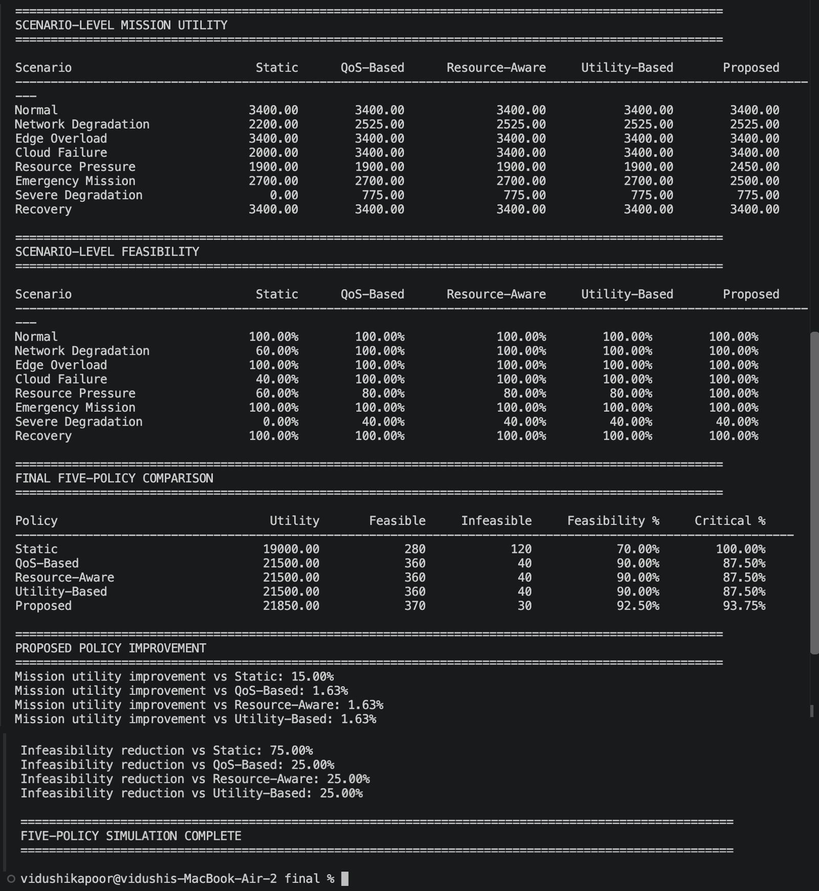
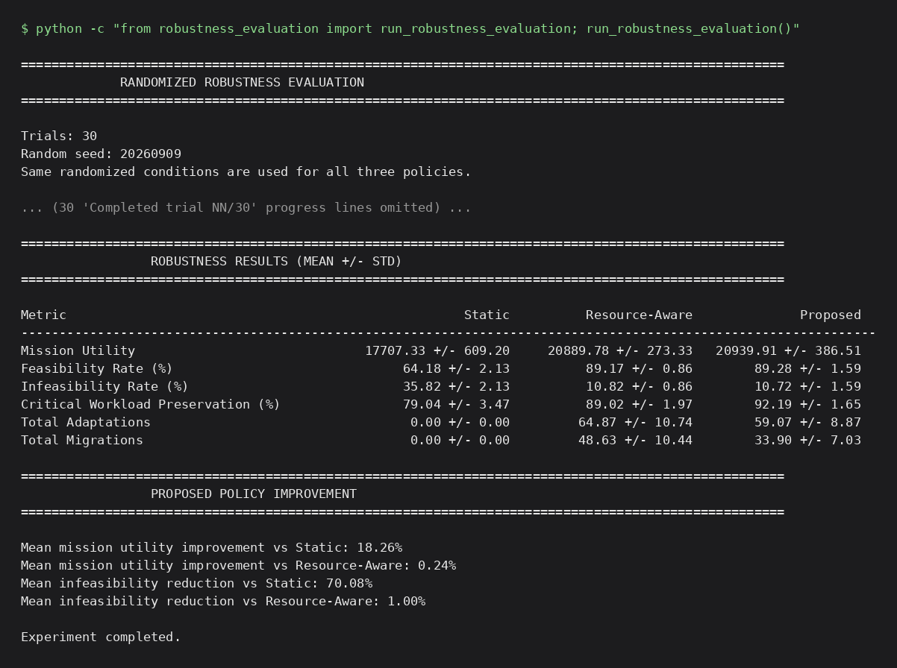
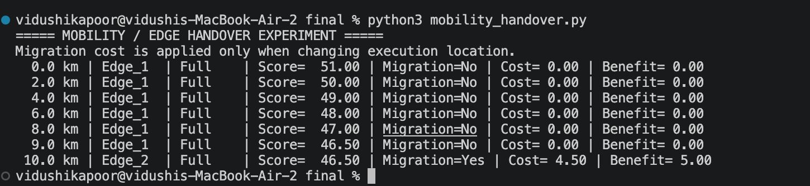
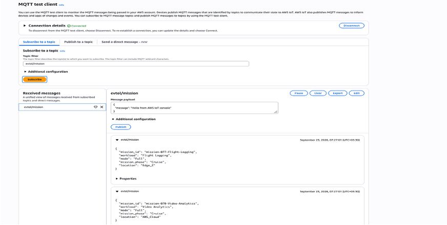

# Mission-Aware Adaptive Workload Orchestration for Cloud–Edge Computing in Urban Air Mobility

Simulation framework and AWS proof-of-concept accompanying the paper
**"Mission-Aware Adaptive Workload Orchestration for Resilient Cloud–Edge Computing in Urban Air Mobility"**
(H. Kumawat, V. Kapoor, P. Gothwal — Vellore Institute of Technology).

An eVTOL aircraft must run several software workloads in flight (obstacle detection, navigation,
weather analysis, video analytics, flight logging) while its compute and network conditions keep
changing. This repository implements a lightweight runtime policy that decides, at every decision step:

1. **where** each workload runs: onboard, Edge 1, Edge 2, or the cloud, and
2. **at what service level**: Full, Reduced, Fallback, or Suspended,

using the current **mission phase**, the **criticality** of each workload, resource and network
state, and the **cost of migrating** a workload between edge nodes as the aircraft moves.

The policy is compared with four baselines (Static, QoS-Based, Resource-Aware, Utility-Based) on an
80-step simulation covering eight operating scenarios. A separate prototype streams the
orchestration decisions to AWS (IoT Core → Lambda → DynamoDB, monitored with CloudWatch).

---

## Contents

- [Quick start](#quick-start)
- [What each script does](#what-each-script-does)
- [Results](#results)
- [System model](#system-model)
- [The proposed policy](#the-proposed-policy)
- [Baselines](#baselines)
- [Repository structure](#repository-structure)
- [AWS prototype](#aws-prototype)
- [Metric definitions and limitations](#metric-definitions-and-limitations)
- [Citation](#citation)

---

## Quick start

**Requirements:** Python **3.12 or newer** (tested on 3.12.3). The simulator and all experiments use
only the standard library, so there is nothing to install to reproduce the results.
`AWSIoTPythonSDK` is needed only for the AWS prototype (`pip install -r requirements.txt`).

```bash
git clone https://github.com/vidushikapoor2006-coder/cloud-project.git
cd cloud-project

# Reproduces the paper's main comparison (Tables I and II). No AWS needed, runs in about a second.
python comparison.py
```

Run all commands from the repository root, since modules are imported as `models.*`,
`orchestrator.*`, `simulation.*` and `baselines.*`.

---

## What each script does

| Command | What it runs | Needs AWS | Paper |
|---|---|:---:|---|
| `python comparison.py` | **Main experiment.** Runs all five policies on the same 80-step timeline and prints overall, per-scenario, feasibility and improvement tables | No | Sec. VI–VII, Tables I–II |
| `python mobility_handover.py` | Isolates Edge 1 → Edge 2 handover as the aircraft moves 0 → 10 km, showing when migration benefit exceeds migration cost | No | Sec. III-B, IV |
| `python -c "from robustness_evaluation import run_robustness_evaluation; run_robustness_evaluation()"` | Supplementary: 30 paired randomized trials (fixed seed `20260909`) comparing Static, Resource-Aware and Proposed; reports mean ± std. Takes a few seconds | No | Supplementary |
| `python main.py` | Step-by-step walkthrough of the proposed policy (feasible actions, scores, per-scenario decisions, adaptation history, timeline) and publishes decisions to AWS IoT Core | **Yes** | Sec. V |
| `python aws_test.py` | Publishes one test mission message to AWS IoT Core | **Yes** | Sec. V |

`main.py` connects to AWS IoT unconditionally, so run `comparison.py` if you do not have the
AWS certificates (see [AWS prototype](#aws-prototype)).

### Expected output of `python comparison.py` (final table)

```
Policy                              Utility       Feasible     Infeasible     Feasibility %     Critical %
--------------------------------------------------------------------------------------------------------------
Static                             19000.00            280            120            70.00%        100.00%
QoS-Based                          21500.00            360             40            90.00%         87.50%
Resource-Aware                     21500.00            360             40            90.00%         87.50%
Utility-Based                      21500.00            360             40            90.00%         87.50%
Proposed                           21850.00            370             30            92.50%         93.75%

Mission utility improvement vs Static: 15.00%
Mission utility improvement vs QoS-Based / Resource-Aware / Utility-Based: 1.63%
Infeasibility reduction vs Static: 75.00%
Infeasibility reduction vs QoS-Based / Resource-Aware / Utility-Based: 25.00%
```



---

## Results

### Deterministic 80-step comparison (paper Tables I and II)

80 decision steps × 5 workloads = 400 workload decisions per policy.

| Policy | Utility | Feasible | Infeasible | Critical (%) | Migrations | Fallbacks | Suspensions |
|---|---:|---:|---:|---:|---:|---:|---:|
| Static | 19000 | 280 | 120 | 100.00 | 0 | 0 | 0 |
| QoS-Based | 21500 | 360 | 40 | 87.50 | 18 | 4 | 1 |
| Resource-Aware | 21500 | 360 | 40 | 87.50 | 15 | 4 | 1 |
| Utility-Based | 21500 | 360 | 40 | 87.50 | 18 | 4 | 1 |
| **Proposed** | **21850** | **370** | **30** | 93.75 | 16 | 6 | 0 |

Per-scenario mission utility:

| Scenario | Static | QoS / Resource / Utility | Proposed |
|---|---:|---:|---:|
| Normal | 3400 | 3400 | 3400 |
| Network Degradation | 2200 | 2525 | 2525 |
| Edge Overload | 3400 | 3400 | 3400 |
| Cloud Failure | 2000 | 3400 | 3400 |
| Resource Pressure | 1900 | 1900 | **2450** |
| Emergency Mission | 2700 | 2700 | 2500 |
| Severe Degradation | 0 | 775 | 775 |
| Recovery | 3400 | 3400 | 3400 |

The Proposed policy's advantage comes entirely from the **Resource Pressure** scenario. There the
baselines let Obstacle Detection take the scarce onboard capacity in Full mode and leave
Navigation with no feasible action, whereas the Proposed policy jointly degrades both critical
workloads (Obstacle Detection to Fallback, Navigation to Reduced) so that both keep running. In
**Emergency Mission** it scores 200 below the baselines: it keeps Video Analytics onboard in
Reduced mode, whereas the baselines move it back to the cloud in Full mode. The proposed policy
charges for that migration and the baselines do not. The three adaptive baselines produce identical
utility and feasibility because they all start from the highest feasible service tier; they differ
in *where* they place workloads, which is why their migration counts differ (see paper, Sec. VII).

### Supplementary: randomized robustness evaluation (30 paired trials, mean ± std)

Each trial applies ±10% random variation to resource usage, network conditions and energy, ±5% to
workload requirements, plus 5% chances of an intermittent disconnect or cloud failure. All three
policies see the identical perturbed state at every step.

| Metric | Static | Resource-Aware | Proposed |
|---|---:|---:|---:|
| Mission utility | 17707 ± 609 | 20890 ± 273 | 20940 ± 387 |
| Feasibility rate (%) | 64.18 ± 2.13 | 89.17 ± 0.86 | 89.28 ± 1.59 |
| Critical workload preservation (%) | 79.04 ± 3.47 | 89.02 ± 1.97 | 92.19 ± 1.65 |
| Total migrations | 0 | 48.6 ± 10.4 | 33.9 ± 7.0 |

Under perturbation the Proposed policy's utility and feasibility are statistically close to
Resource-Aware (+0.24% utility, within one standard deviation). Its measurable differences are
higher critical-workload preservation and substantially fewer migrations. Note that this
experiment counts a critical workload as preserved only when its action is actually feasible, which
differs from the Table I definition (see [Metric definitions](#metric-definitions-and-limitations)).



### Edge handover (`mobility_handover.py`)

Edge 1 sits at 0 km and Edge 2 at 10 km. Edge latency grows by 5 ms per km of distance. The
workload stays on Edge 1 until the benefit of moving exceeds the analytical migration cost, then
hands over near the Edge 2 position:

```
  0.0 km | Edge_1  | Full | Score=  51.00 | Migration=No  | Cost= 0.00 | Benefit= 0.00
  ...
  9.0 km | Edge_1  | Full | Score=  46.50 | Migration=No  | Cost= 0.00 | Benefit= 0.00
 10.0 km | Edge_2  | Full | Score=  46.50 | Migration=Yes | Cost= 4.50 | Benefit= 5.00
```



---

## System model

**Execution locations:** `Onboard`, `Edge_1`, `Edge_2`, `AWS_Cloud`.
**Service modes:** `Full`, `Reduced` (50% of compute/memory/energy), `Fallback` (20%), `Suspended` (0%).
**Mission phases:** Takeoff, Cruise, Approach, Landing, Emergency.

### Workloads

| Workload | Criticality | Deadline (ms) | CPU | Memory | Energy | Network | Allowed locations |
|---|---|---:|---:|---:|---:|---:|---|
| Obstacle Detection | VERY_HIGH | 50 | 30 | 20 | 15 | 10 | Onboard, Edge 1, Edge 2 (Fallback onboard only); never suspended |
| Navigation | VERY_HIGH | 50 | 35 | 25 | 15 | 10 | Same as above; never suspended |
| Weather Analysis | HIGH | 200 | 20 | 15 | 8 | 20 | Edges, Cloud; Fallback onboard; may be suspended |
| Video Analytics | MEDIUM | 150 | 30 | 20 | 10 | 30 | Edges, Cloud (Reduced also onboard); may be suspended |
| Flight Logging | LOW | 500 | 10 | 10 | 3 | 5 | Edges, Cloud; Fallback onboard; may be suspended |

### Resources and network (Normal conditions)

| Resource | CPU capacity / used | Memory capacity / used |
|---|---|---|
| Onboard | 100 / 20 | 100 / 20 |
| Edge 1 | 100 / 30 | 100 / 25 |
| Edge 2 | 100 / 40 | 100 / 30 |
| Cloud | 200 / 50 | 200 / 40 |

Network: 50 ms latency, 100 bandwidth, 1% packet loss, connected.

### The 80-step timeline (10 steps per scenario)

| Steps | Scenario | What changes |
|---|---|---|
| 0–9 | Normal | Baseline conditions |
| 10–19 | Network Degradation | 300 ms latency, bandwidth 40, 20% packet loss |
| 20–29 | Edge Overload | Edge 1 at 95/90, Edge 2 at 90/85 (CPU/memory used) |
| 30–39 | Cloud Failure | Cloud unavailable |
| 40–49 | Resource Pressure | Onboard 70/70 and energy 45; edges 80/75 and 85/80; cloud 75/70; 180 ms, bandwidth 60, 10% loss |
| 50–59 | Emergency Mission | Mission phase switches to Emergency (utilities re-weighted) |
| 60–69 | Severe Degradation | Onboard 90/90 and energy 25; edges 95/90; cloud down; 400 ms, bandwidth 20, 30% loss, **disconnected** |
| 70–79 | Recovery | Back to normal conditions |

**Mobility:** the eVTOL position advances 0.125 km per step (capped at 10 km). Edge latency is
`network_latency + 5 ms × distance_to_edge`.

---

## The proposed policy

Implemented in `orchestrator/decision.py` (`select_actions_globally`). At each step:

**1. Hard feasibility (`orchestrator/feasibility.py`).** An action `(location, mode)` is considered
only if the resource has enough CPU, memory and energy; the network is connected with enough
bandwidth (remote locations only); the estimated latency meets the workload deadline; and the mode
is allowed for that workload (critical workloads can never be suspended).

**2. Scoring (`orchestrator/utility.py`).**

```
Score = Utility − LatencyCost − EnergyCost − ResourceCost − MigrationCost

Utility       = MissionImportance(workload, phase) × Quality(workload, mode)
LatencyCost   = (estimated_latency / deadline) × 20
EnergyCost    = energy_requirement × mode_factor
ResourceCost  = (cpu_required / cpu_capacity) × 20
```

**3. Migration cost (`calculate_migration_cost`; details in
[`README_MIGRATION_COST.md`](README_MIGRATION_COST.md)).** Changing location is a soft cost, not a hard constraint:

```
T_mig = (state_size / bandwidth) × 1000 + path_latency + 5 ms
C_mig = (T_mig / deadline) × 20
```

A migration is accepted only if the operating-score improvement exceeds `C_mig`, or if the current
placement has become infeasible (recovery). Initial placement is never charged.

**4. Two-phase allocation.**
- **Phase 1 – critical workloads (Obstacle Detection, Navigation)** are chosen *jointly* by
  exhaustive search over their feasible action combinations. Ranking is lexicographic: maximize
  total utility, then the minimum quality across the critical workloads, then minimize cost.
  Critical workloads are never intentionally suspended.
- **Phase 2 – remaining workloads**, in descending criticality, take the leftover resources,
  maximizing mission utility first and using the score only as a tie-breaker.

**5. Adaptation tracking (`orchestrator/history.py`).** Each decision is classified as
Migration, Degradation, Fallback, Suspension, Recovery, or a combination.

---

## Baselines

All baselines use the same workloads, scenarios, hard feasibility rules and per-step resource
accounting as the proposed policy, so differences come only from the decision rule.

| Policy | File | Decision rule |
|---|---|---|
| Static | `baselines/static_baseline.py` | Fixed placement: critical workloads onboard, all others in the cloud, always Full mode; never adapts |
| QoS-Based | `baselines/qos_based.py` | Highest feasible service tier, then minimize `0.50·latency + 0.25·bandwidth_penalty + 0.25·packet_loss` |
| Resource-Aware | `baselines/resource_aware.py` | Highest feasible service tier, then minimize `0.40·latency + 0.30·energy + 0.30·resource_use` |
| Utility-Based | `baselines/utility_based.py` | Maximize mission utility per workload, ties broken by lower latency; no joint critical-workload protection |
| **Proposed** | `orchestrator/decision.py` | Mission-aware, criticality-first joint selection with migration-cost gating (above) |

---

## Repository structure

```
.
├── comparison.py               # Main experiment: five-policy comparison (paper Tables I-II)
├── robustness_evaluation.py    # Supplementary: 30 paired randomized trials
├── mobility_handover.py        # Edge 1 -> Edge 2 handover experiment
├── main.py                     # Walkthrough of the proposed policy + AWS IoT publishing
├── aws_test.py                 # Publishes a single test message to AWS IoT Core
├── metrics.py                  # Per-scenario metrics used by main.py
├── evaluation.py               # Aggregation helpers for a 3-policy evaluation
├── README_MIGRATION_COST.md    # Migration cost model
├── requirements.txt
│
├── aws/
│   └── lambda_handler.py       # Lambda: records each IoT message in DynamoDB
├── docs/
│   └── images/                 # Screenshots used in this README
│
├── models/                     # Data model
│   ├── workload.py             #   Workload, Criticality, ExecutionMode, Location
│   ├── resource.py             #   ResourceState (CPU, memory, energy, availability)
│   ├── mission.py              #   MissionPhase, MissionState, NetworkState
│   └── state.py                #   SystemState (the S_t tuple of the paper)
│
├── orchestrator/               # Proposed policy
│   ├── decision.py             #   Joint critical selection, migration cost, two-phase allocation
│   ├── feasibility.py          #   Action space and hard constraints (Eq. 8)
│   ├── utility.py              #   Utility, cost terms, score (Eqs. 6, 9)
│   ├── resource_manager.py     #   Per-step resource accounting across workloads
│   ├── runtime.py              #   Workload runtime state updates
│   └── history.py              #   Adaptation classification and event log
│
├── baselines/                  # Comparison policies
│   ├── static_baseline.py, static_runner.py
│   ├── qos_based.py
│   ├── resource_aware.py, resource_runner.py
│   └── utility_based.py
│
├── simulation/                 # Experiment definition
│   ├── scenarios.py            #   The eight scenarios
│   ├── timeline.py             #   The 80-step timeline
│   └── records.py              #   TimeStepRecord
│
└── execution/                  # AWS prototype and execution stubs
    ├── aws_iot_client.py       #   MQTT client for AWS IoT Core
    ├── cloud_executor.py       #   Simulated cloud execution stub
    ├── local_executor.py       #   Simulated onboard execution stub
    └── certs/                  #   AWS IoT certificates (NOT committed; see below)
```

**Notes.** `comparison.py` contains its own policy runners that also count adaptations and
migrations, and it produces the numbers in the paper. `baselines/static_runner.py` and
`baselines/resource_runner.py` are simpler runners used by `main.py`, and they do not track
adaptations. `evaluation.py`, `cloud_executor.py` and `local_executor.py` are not called by the
entry scripts above.

---

## AWS prototype

The prototype shows how the orchestrator's decisions could be streamed to a cloud back end. As in
the paper, the Python simulator makes **all** orchestration decisions; AWS provides communication,
storage and monitoring and does **not** execute the eVTOL workloads.

```
Python eVTOL simulator ──MQTT (TLS, port 8883)──► AWS IoT Core ──IoT rule──► AWS Lambda ──► DynamoDB
                                                                                │
                                                                                └──► CloudWatch (logs, metrics)
```

- **Topic:** `evtol/mission`, QoS 1, client ID `eVTOL-001`
- **Region:** `ap-south-1` (Mumbai)
- **Message format** (`execution/aws_iot_client.py → publish_mission`):

  ```json
  {
    "mission_id": "mission-010-Navigation",
    "workload": "Navigation",
    "mode": "Full",
    "mission_phase": "Cruise",
    "location": "Onboard"
  }
  ```

- **What `main.py` publishes:** the initial placement at `t = 0` plus every step where a workload
  actually adapts, rather than all 400 decisions.

### Reproducing the prototype

1. **Create an AWS IoT *Thing*** with a certificate and a policy that allows
   `iot:Connect`, `iot:Publish` (on `evtol/mission`). Download the device certificate, private
   key and Amazon Root CA 1.
2. **Place the three files in `execution/certs/`** and set `ENDPOINT` and the certificate file
   names at the top of `execution/aws_iot_client.py` to match your account.
3. **Create a DynamoDB table** named `MissionOrchestration` with `mission_id` (String) as the
   partition key.
4. **Create the Lambda function** (Python runtime) from [`aws/lambda_handler.py`](aws/lambda_handler.py)
   and give its execution role `dynamodb:PutItem` on that table. The handler records the placement
   the simulator chose; it does not decide or execute anything. Lambda logs go to CloudWatch
   automatically.
5. **Add an IoT rule** with the query `SELECT * FROM 'evtol/mission'` and an action that invokes
   the Lambda function.
6. **Install the SDK and send a test message:**

   ```bash
   pip install -r requirements.txt
   python aws_test.py
   ```

   Then run `python main.py` for the full timeline.

> **Security:** `execution/certs/` holds a private key and must never be committed. The provided
> `.gitignore` excludes `certs/`, `*.pem`, `*.key` and `*.crt`.

### Screenshots

| AWS IoT Core (MQTT test client, topic `evtol/mission`) | DynamoDB (`MissionOrchestration` table) |
|---|---|
|  |  |

---

## Metric definitions and limitations

**Critical Workload Preservation (CWPR).** Two definitions are used, and they are not interchangeable:

- *`comparison.py` / paper Table I:* the share of Obstacle Detection and Navigation decisions that
  were kept in an executable mode (Full, Reduced or Fallback) rather than deliberately suspended or
  left without an action. Static scores 100% because it never changes its fixed onboard
  assignment, even when that assignment is infeasible. The metric therefore measures *not being
  sacrificed*, not *being served successfully*. The paper discusses this in Sec. VII.
- *`robustness_evaluation.py`:* the share of critical decisions whose chosen action is actually
  feasible under the perturbed conditions. This is why Static scores 79%, not 100%, there.

**Other limitations.**

- Everything is a simulation. Migration time is **analytical** (state size, bandwidth, latency,
  fixed overhead), not a measured state transfer, and it does not model aircraft communication energy.
- Migration cost is modelled only in the proposed policy. The baselines never compute it, so the
  "Total Migration Cost" row printed for them in `comparison.py` is 0.00 because it is not modelled,
  not because their migrations are free.
- Mobility is one-dimensional with two edge nodes at fixed positions (0 km and 10 km).
- The scenario timeline is deterministic. The randomized robustness evaluation is the only
  stochastic experiment and is not part of the paper's reported results.
- Edge-to-edge handover cost assumes a fixed 20 ms path latency and a 1 MB workload state.

---

## Citation

```
H. Kumawat, V. Kapoor, and P. Gothwal, "Mission-Aware Adaptive Workload Orchestration for
Resilient Cloud–Edge Computing in Urban Air Mobility," Vellore Institute of Technology, Vellore,
India. Manuscript.
```

Code: <https://github.com/vidushikapoor2006-coder/cloud-project>