# Mission-Aware Adaptive Workload Orchestration for Resilient Cloud–Edge Computing in Urban Air Mobility

Simulator, orchestration policies, baselines, experiment pipeline and AWS proof-of-concept accompanying the paper of the same title.

The code places the computing workloads of an eVTOL (electric vertical take-off and landing) aircraft on onboard, edge or cloud resources. It also chooses a service mode for each workload (Full, Reduced, Fallback or Suspended) as the mission phase, network conditions and resource availability change.

> **Scope.** All results come from a seeded, synthetic simulation. The AWS integration shows that orchestration decisions can be sent, processed, stored and monitored. It does not run the flight workloads on AWS, and it says nothing about safety certification or operational flight readiness.

---

## Contents

1. [Overview](#1-overview)
2. [Main results](#2-main-results)
3. [Installation](#3-installation)
4. [Running the code](#4-running-the-code)
5. [Repository structure](#5-repository-structure)
6. [AWS proof-of-concept](#6-aws-proof-of-concept)
7. [Response to reviewers](#7-response-to-reviewers)
8. [Modelling assumptions and limitations](#8-modelling-assumptions-and-limitations)
9. [Screenshots](#9-screenshots)
10. [Citation](#10-citation)

---

## 1. Overview

### Workloads

| Workload | Criticality | Deadline | Allowed hosts |
|---|---|---:|---|
| Obstacle Detection | Very high | 50 ms | Onboard only |
| Navigation | Very high | 50 ms | Onboard only |
| Weather Analysis | High | 200 ms | Onboard, Edge 1, Edge 2, Cloud |
| Video Analytics | Medium | 150 ms | Onboard, Edge 1, Edge 2, Cloud |
| Flight Logging | Low | 500 ms | Onboard, Edge 1, Edge 2, Cloud |

The two flight-critical workloads run **only onboard**, under every policy. If no onboard mode is feasible, the workload is reported as *infeasible*. It is never offloaded or suspended.

### Proposed policy

The proposed policy decides in two phases at every step:

1. **Critical admission.** Obstacle Detection and Navigation are admitted jointly onboard. The policy maximises, in order: the number of critical workloads served, their utility, the lowest service quality among them, and then lower cost.
2. **Non-critical placement.** The remaining workloads are handled in order of their mission-phase importance. For each one, the policy picks a host and service mode by utility, using operating cost minus migration cost as the tie-breaker.

A placement is feasible only if it satisfies the resource limits, link availability and edge coverage (8 km radius) and meets the deadline. Response time accounts for packet loss.

### Scenarios

The simulation runs an 80-step mission through eight scenarios: Normal, Network Degradation, Edge Overload, Cloud Failure, Resource Pressure, Emergency Mission, Severe Degradation and Recovery. Within each scenario, latency, bandwidth, packet loss, background load, energy, demand, edge contention, connectivity, cloud failure/recovery and aircraft mobility all vary over time. This variation is generated from fixed random seeds (ramps, Ornstein–Uhlenbeck noise, a Gilbert–Elliott link model and AR(1) demand). These are modelled dynamics, not measured traces.

### Compared methods

| Name in paper | Identifier in code / CSV | Description |
|---|---|---|
| Static | `Static` | Fixed onboard allocation |
| QoS-Based, Resource-Aware, Utility-Based | same | Original adaptive baselines |
| AMC-inspired | `AMC-Adapted` | Adaptation of Adaptive Mixed-Criticality principles |
| EMC-inspired | `Elastic-MC` | Adaptation of Elastic Mixed-Criticality principles |
| MDP-Migration | `MDP-Migration` | Adaptation of MDP-based service migration (Wang et al., IEEE/ACM ToN 2019) |
| RH-DP / RH-DP-Oracle | same | Five-step receding-horizon dynamic programming reference (top-4 candidate pruning) |
| Proposed-v1 | `Proposed-v1` | Policy as originally submitted |
| **Proposed** | `Proposed` | Revised policy (Algorithm 1 in the paper) |

The mixed-criticality and MDP baselines adapt the published principles to this setting; they are not exact reimplementations. RH-DP prunes candidates and scalarises its objective, so it is a strong reference, not an exact optimum.

---

## 2. Main results

30 trials with shared seeds (base seed `20260909`). Values are means; ± is the 95% confidence interval.

| Policy | Utility delivered | Critical execution success | Critical non-suspension | Completion | Deadline-miss ratio | Migrations |
|---|---:|---:|---:|---:|---:|---:|
| Static | 17,595 ± 133 | 78.1% | 100.0% | 64.1% | 35.9% | 0.0 |
| QoS-Based | 20,423 ± 132 | 90.6% | 92.4% | 83.4% | 4.6% | 37.1 |
| Resource-Aware | 20,425 ± 132 | 90.6% | 92.4% | 83.4% | 4.6% | 34.3 |
| Utility-Based | 20,423 ± 132 | 90.6% | 92.4% | 83.4% | 4.6% | 37.1 |
| AMC-inspired | 19,601 ± 131 | 94.4% | 95.9% | 71.7% | 2.2% | 14.2 |
| EMC-inspired | 20,737 ± 110 | 94.4% | 95.9% | 86.0% | 4.4% | 38.5 |
| MDP-Migration | 20,418 ± 130 | 90.6% | 92.4% | 83.4% | 4.6% | 28.7 |
| Proposed-v1 | 20,168 ± 154 | 93.9% | 95.9% | 83.3% | 4.6% | 20.1 |
| RH-DP | 20,726 ± 109 | 93.9% | 95.9% | 84.6% | 4.6% | 31.4 |
| **Proposed** | **20,711 ± 109** | **93.9%** | **95.9%** | **84.5%** | **4.7%** | **29.2** |

Paired Wilcoxon signed-rank tests with Holm correction show:

* **Proposed delivers more utility than** Static, QoS-Based, Resource-Aware, Utility-Based, AMC-inspired, MDP-Migration and Proposed-v1 (all adjusted p < 0.001).
* **Proposed and EMC-inspired are statistically tied on utility** (difference −26, adjusted p = 0.135). The proposed policy reaches this with fewer migrations (29.2 vs 38.5).
* **RH-DP is slightly ahead** (+16 utility points, about 0.1%) but needs about 28× the decision time. In the runtime benchmark, the proposed policy averages 353 µs per decision (95th percentile 647 µs) and RH-DP averages about 9.8 ms.
* **Critical execution success and critical non-suspension are different measures.** Static never suspends a critical workload (100% non-suspension), but its fixed onboard allocation often cannot actually run them (78.1% execution success).

The ablation, sensitivity and runtime results are in the paper. The data behind them is in `results/ablation`, `results/sensitivity` and `results/runtime`.

---

## 3. Installation

Requires Python 3.12 or later (tested with 3.13 and 3.14).

```bash
git clone <repository-url>
cd <repository-folder>
python3 -m venv .venv
source .venv/bin/activate          # Windows PowerShell: .venv\Scripts\Activate.ps1
python3 -m pip install -r requirements.txt
```

The AWS SDK is needed only for the optional AWS integration:

```bash
python3 -m pip install AWSIoTPythonSDK
```

---

## 4. Running the code

### Tests

```bash
python3 -m pytest -v tests/
```

The 34 tests cover the onboard-only safety rule, feasibility, migration cost, utility, phase-aware ordering, the mixed-criticality and MDP baselines, the look-ahead reference, ablation variants and reproducibility.

### Reproduce every result in the paper

```bash
./run_all.sh
```

This runs all experiments and regenerates every table, figure and number reported in the paper from the raw logs. It takes about 15 minutes on two CPU cores.

### Individual experiments

```bash
python3 -m experiments.run_experiments --trials 30 --tag main      # main study
python3 -m experiments.run_experiments --legacy --tag legacy       # original deterministic timeline
python3 -m experiments.run_experiments --ablation --tag ablation   # component ablation
python3 -m experiments.analyze --tag main                          # CIs, Wilcoxon + Holm
python3 -m experiments.sensitivity --trials 30                     # parameter sweeps
python3 -m experiments.benchmark_runtime                           # decision-time benchmark
python3 -m experiments.make_tables
python3 -m experiments.make_figures
```

Options for `run_experiments`:

| Option | Effect |
|---|---|
| `--noise <value>` | Scale of stochastic variation (0 reproduces the original deterministic timeline) |
| `--profile flight\|cruise_only` | Mission-phase profile |
| `--coverage <km>\|none` | Edge coverage radius |
| `--policies "Proposed,Elastic-MC"` | Restrict the run to selected policies |
| `--network-trace <file.csv>` | Replace synthetic network conditions with a trace (`t,latency_ms,bandwidth,loss_pct,connected`) |

**Reproducibility.** Trial seeds are derived from `config.BASE_SEED` with `numpy.random.SeedSequence`. Each run saves its seeds, library versions and a snapshot of `config.py` to `results/<tag>/manifest.json`. All policies in a trial run on the same pre-generated trace. Reported decision time covers only the policy's decision call; simulation, logging and AWS publishing are excluded.

### Original demonstration scripts

```bash
python3 main.py              # scenario walk-through with placements and adaptation history
python3 comparison.py        # original five-policy comparison on the deterministic timeline
```

These scripts are kept from the original submission. `comparison.py` reports the original "critical preservation" metric on a single deterministic run. The 30-trial results in [Section 2](#2-main-results) replace it.

---

## 5. Repository structure

| Path | Content |
|---|---|
| `config.py` | Every simulation parameter, with its units and source. The paper's parameter tables are generated from this file. |
| `models/` | Workload, resource, mission and system-state classes |
| `orchestrator/feasibility.py` | Hard constraints shared by all policies: onboard-only rule, resources, link and coverage, packet-loss-aware latency, deadlines |
| `orchestrator/utility.py` | Utility and cost terms |
| `orchestrator/migration.py` | Analytical migration time and cost |
| `orchestrator/decision.py` | Revised proposed policy (Algorithm 1) |
| `orchestrator/decision_v1.py` | Policy as originally submitted |
| `orchestrator/lookahead.py` | RH-DP and RH-DP-Oracle |
| `baselines/` | Static, QoS-Based, Resource-Aware, Utility-Based, mixed-criticality-inspired and MDP-Migration baselines |
| `policies.py` | Common interface and registry of all policies and ablation variants |
| `simulation/` | Environment dynamics, scenario timeline and execution engine |
| `metrics.py` | Scenario and episode metrics |
| `experiments/` | Experiment runner, statistics, sensitivity, runtime benchmark, table/figure generation, AWS latency probe |
| `results/` | Raw logs, manifests and aggregated results for every experiment in the paper |
| `generated/`, `figures/` | LaTeX tables, result macros and figures used in the paper |
| `tests/` | Automated tests |
| `execution/` | AWS IoT Core MQTT client and executors |
| `main.py`, `comparison.py`, `evaluation.py`, `robustness_evaluation.py`, `mobility_handover.py` | Original scripts |

---

## 6. AWS proof-of-concept

### Architecture

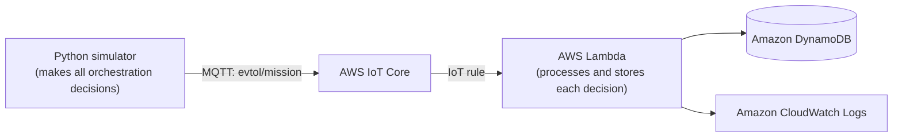

All placement and service-mode decisions are made in the Python simulator. AWS receives them, processes and stores them, and makes them observable. The deployment uses the `ap-south-1` region and these resources:

| Component | Name |
|---|---|
| MQTT client ID | `eVTOL-001` |
| MQTT topic | `evtol/mission` |
| IoT rule | `eVTOLMissionToLambda` |
| Lambda function | `mission-aware-cloud-processor` |
| DynamoDB table | `MissionOrchestration` |

The AWS resources are created in the AWS account; this repository does not provision them.

### Running it

Set the connection details through environment variables. No certificates or keys are included in this repository.

```bash
export AWS_IOT_ENDPOINT="<your-endpoint>-ats.iot.<region>.amazonaws.com"
export AWS_IOT_CLIENT_ID="eVTOL-001"
export AWS_IOT_TOPIC="evtol/mission"
export AWS_IOT_ROOT_CA="/path/to/AmazonRootCA1.pem"
export AWS_IOT_CERT="/path/to/device-certificate.pem.crt"
export AWS_IOT_PRIVATE_KEY="/path/to/private.pem.key"

python3 aws_test.py          # publish a single test message
python3 main.py --aws        # publish the initial placement and every subsequent adaptation
```

With `--aws`, MQTT publish time is reported separately from decision time.

### Message format

```json
{
  "mission_id": "mission-050-Video-Analytics",
  "workload": "Video Analytics",
  "mode": "Full",
  "mission_phase": "CRUISE",
  "location": "Edge_1"
}
```

The Lambda function stores each event under a newly generated UUID (the table's `mission_id` partition key). The original identifier is kept in `source_mission_id`, so repeated events for the same workload never overwrite each other.

### Observed behaviour

In the recorded run, CloudWatch logged the receipt and storage of each decision. For the example event `mission-050-Video-Analytics`, the logs show 20.3 ms of processing inside the function and a billed Lambda duration of 41.3 ms. That is a single observation. End-to-end AWS latency was not measured for the paper. `experiments/aws_latency_probe.py` is provided for measuring it, but its results are not part of the reported evaluation.

---

## 7. Response to reviewers

This section summarises how the revision addresses each reviewer comment. The full point-by-point response accompanies the revised manuscript.

### Reviewer 2

| Comment | Revision |
|---|---|
| Clarify novelty relative to mixed-criticality scheduling and existing placement/migration work | The novelty claim is narrowed. Degradation, offloading, placement and migration are each acknowledged as established techniques. The contribution is framed as their integration: mission-phase importance, joint host and service-mode selection for non-critical workloads, mobility-dependent migration cost, and onboard-only admission for flight-critical workloads. |
| Compare against established methods from the literature | Added AMC-inspired, EMC-inspired and MDP-Migration baselines, plus the RH-DP look-ahead reference. They are described as adaptations of published principles. |
| Provide a parameter table with descriptions, values and formulae | Table I lists workload parameters and phase-dependent importance and quality. Table II lists simulation parameters with values, units and sources. Equations (4)–(8) define utility, response time, resource constraints, migration cost and the operating score. All values come from `config.py`. |
| Support the "lightweight" claim | Added pseudocode (Algorithm 1), candidate counts, worst-case time and memory complexity, and measured decision times (353 µs per decision on average). The claim applies only to the general-purpose machine used for the measurements. |
| Compare the greedy policy with dynamic programming / look-ahead, since mission phases are known | Added the five-step RH-DP reference and an oracle variant. RH-DP gains about 0.1% utility at about 28× the decision time, so the one-step policy is retained. |
| The simulation is static, with flat utility in each scenario | The environment now varies within each scenario (network, load, energy, demand, contention, connectivity, cloud failure, mobility). Results are reported over 30 seeded trials. |
| The proposed policy scores lower than the baselines in the Emergency scenario | Fixed the migration gate and added phase-dependent ordering of non-critical workloads. The proposed policy now matches the best baselines in Emergency; it is not claimed to exceed them. |
| Static reports 100% critical preservation despite poor utility | The paper now reports critical non-suspension and critical execution success separately (Section 2 above). |
| Flight-critical tasks should stay onboard | Obstacle Detection and Navigation are restricted to onboard execution for every policy and checked by automated tests. |
| Redundant figures | Each remaining figure has its own role (topology, AWS architecture, utility over time). The redundant comparison matrix was removed. |
| Unclear wording | The manuscript was rewritten in more direct technical language, with precise definitions of placement, degradation, fallback, migration and suspension. |

### Reviewer 4

| Comment | Revision |
|---|---|
| Explain the mathematical formulation more clearly | Sections III–IV define the state, action space, onboard-only constraint, utility, response-time and resource constraints, migration cost, the lexicographic objectives and the two-phase algorithm. The notation matches the code. |
| Add repeated simulations and more metrics | 30 shared-seed trials with 95% confidence intervals and paired Wilcoxon tests with Holm correction. Metrics include utility, critical execution success, non-suspension, deadline misses, completion, infeasibility, migrations, migration overhead, energy, utilisation and decision time. |
| Validate under realistic operating conditions | The simulator now models stochastic, time-varying network and resource conditions, mobility, edge contention, intermittent connectivity and delayed cloud recovery. A real network trace can be supplied with `--network-trace`. No operational trace or hardware-in-the-loop experiment is included; the paper states this limitation. |

### Reviewer 6

| Comment | Revision |
|---|---|
| Define acronyms (eVTOL, UAV, QoS, ...) | All acronyms are defined at first use in the abstract and the main text. |
| Standardise mathematical writing and punctuation | Equations and the surrounding text were revised for consistent notation and punctuation. |
| Discuss the figures in the text | The text now explains the AWS architecture figure along the data path, and the utility-over-time figure, including within-scenario variation and the scenarios where policies differ. |

---

## 8. Modelling assumptions and limitations

* All environment dynamics are synthetic. Parameters marked "this rev." in `config.py` are modelling assumptions, not measurements, and the sensitivity analysis varies them.
* Reduced and Fallback are abstract service modes, modelled as a resource scale and a quality factor. No degraded algorithms are implemented.
* Migration is modelled analytically. The default treats it as live migration, with downtime as a soft cost (`MIGRATION_DOWNTIME_IN_DEADLINE=True` gives the cold-migration variant). Migration energy is not modelled.
* Packet loss inflates network delay by a factor of 1/(1−p), with p capped at 0.95.
* Edge and cloud energy budgets are constant. The onboard energy budget varies over the mission.
* The mixed-criticality and MDP baselines adapt published principles; they are not exact reimplementations.
* Neither trace-driven operational validation nor hardware-in-the-loop testing is claimed.
* The AWS integration covers decision transport, processing, storage and monitoring, not workload execution.

---

## 9. Screenshots

### Repository structure

<p>
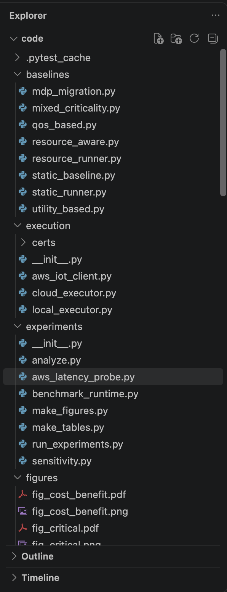
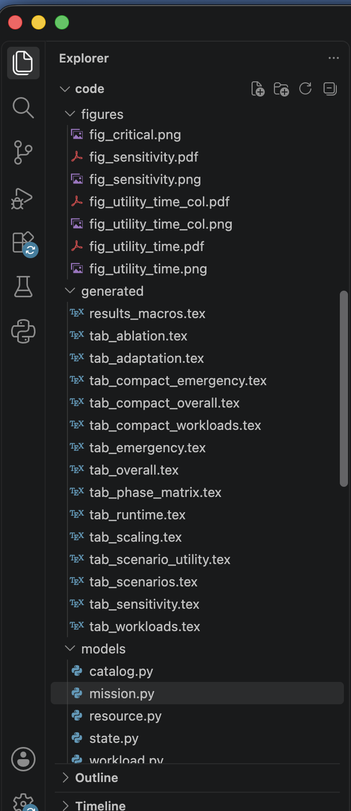
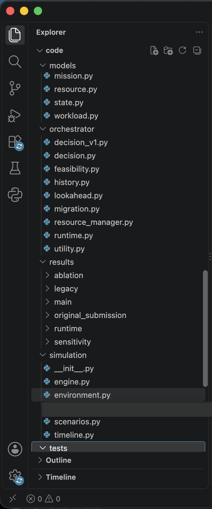
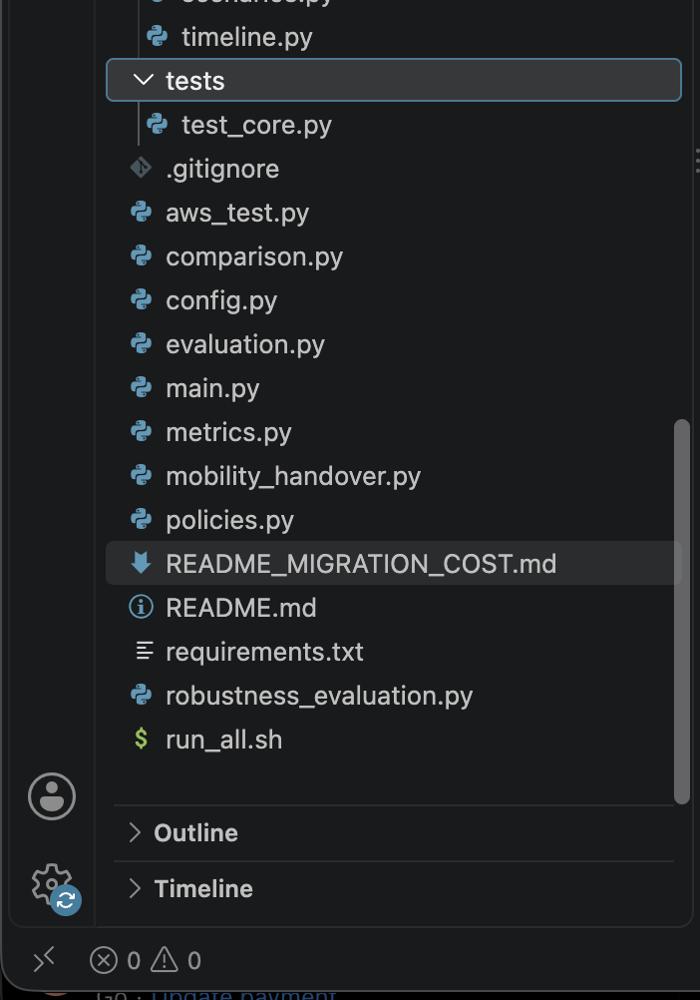
</p>

### Automated tests

All 34 tests pass.

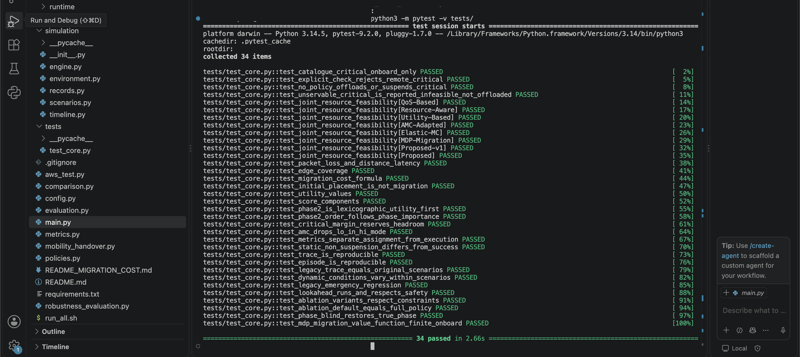

### Simulation run (`main.py --aws`)

The run prints the workload catalogue, the available resources and the feasible actions for each workload. Obstacle Detection and Navigation have onboard options only.

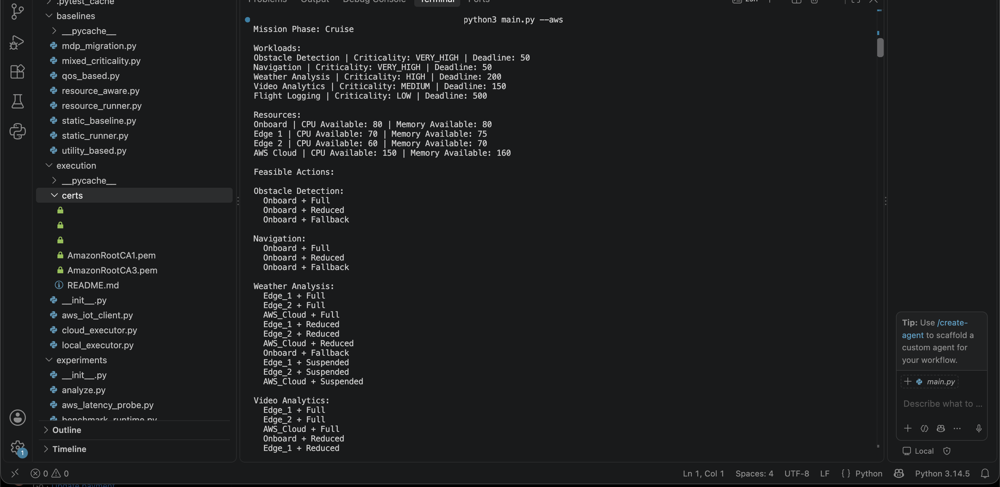

### Adaptation history

The run shows initial placement, migration, fallback, degradation, suspension and recovery across the eight scenarios. Obstacle Detection and Navigation stay onboard throughout.

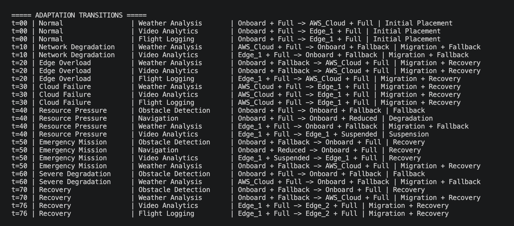

### Original five-policy script (`comparison.py`)

This is the comparison script from the original submission. It runs a single deterministic timeline and reports the original "critical preservation" metric (non-suspension). The 30-trial results in [Section 2](#2-main-results) replace it.

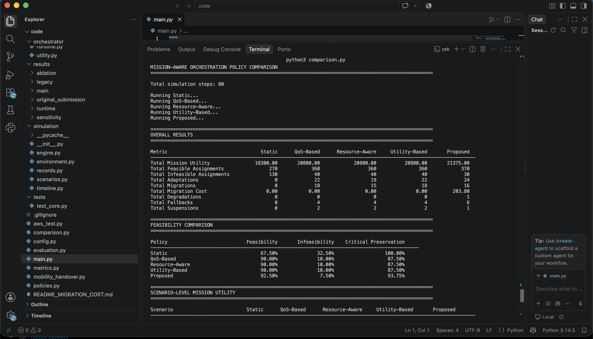

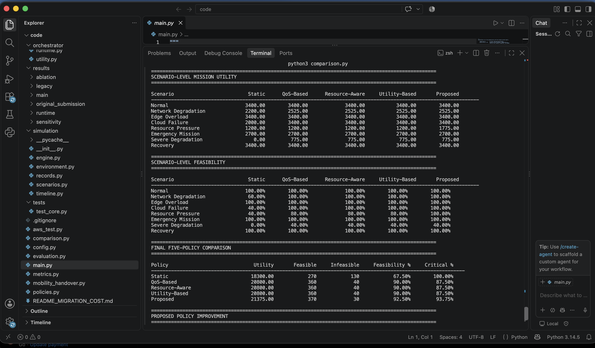

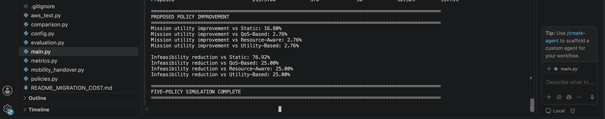

### AWS: CloudWatch log streams

Log streams of the `mission-aware-cloud-processor` Lambda function.

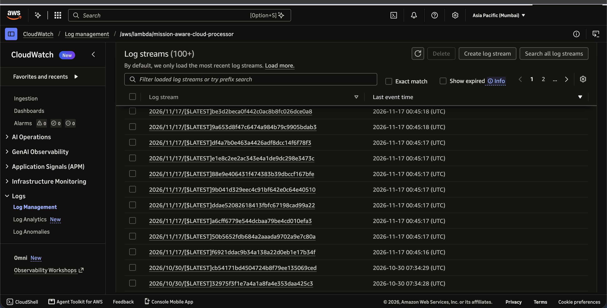

### AWS: Lambda log events

A decision (`mission-050-Video-Analytics`) is received, stored under a generated UUID and logged with its processing time.

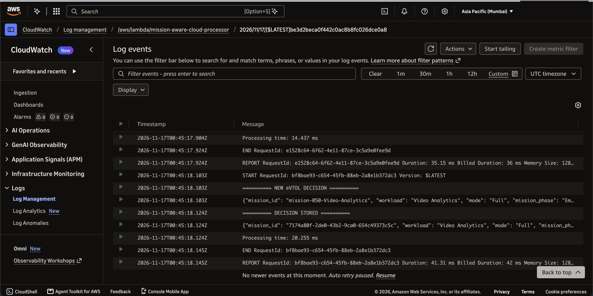

### AWS: DynamoDB records

The `MissionOrchestration` table. Rows keyed by a UUID were written by the current version. Rows keyed by a readable mission name, such as `mission-040-...`, as well as `mission-001` and `integration-test-001`, come from earlier development and connectivity tests, before the onboard-only rule and UUID keys were introduced. They do not reflect the current policy.

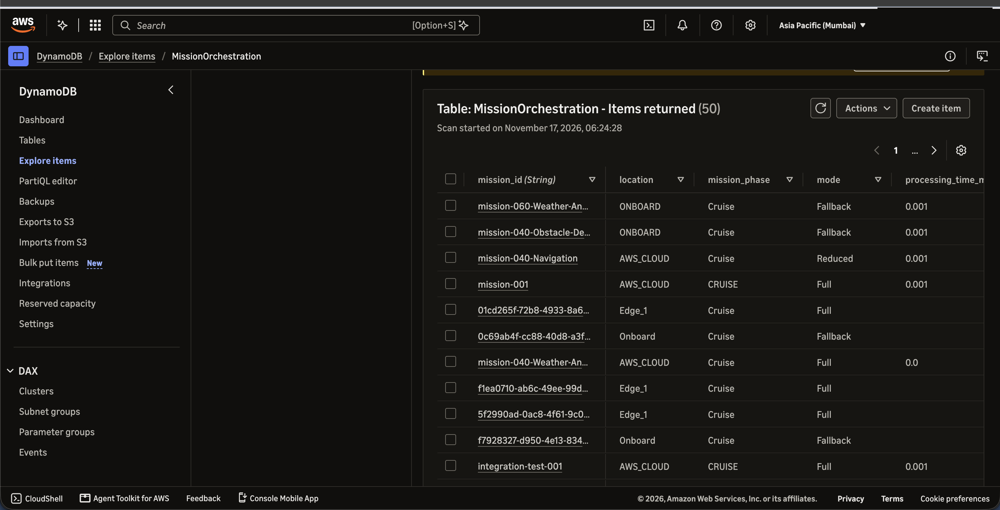

---

## 10. Citation

If you use this code, please cite the accompanying paper:

> *Mission-Aware Adaptive Workload Orchestration for Resilient Cloud–Edge Computing in Urban Air Mobility.*

Full bibliographic details will be added once the paper is published.
